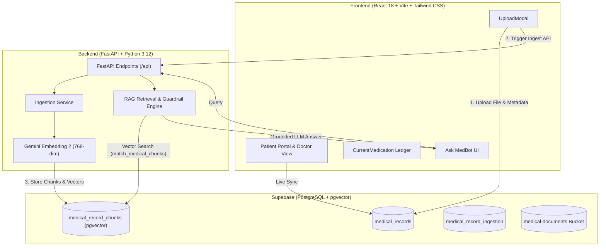

# Hola — Unified Federated Patient Health Records & Clinical RAG Platform

> **Hola** is a federated digital health platform that unifies prescriptions, lab reports, medical scans, and clinical history into a single, patient-centric ecosystem. Featuring direct Supabase vector database synchronization, an end-to-end multimodal **Retrieval-Augmented Generation (RAG)** clinical assistant (**MedBot**), a doctor QR review portal, and proactive medication reminder schedules.

---

## 🌟 Key Features

### 1. 🪪 Permanent Health ID Authentication
- **Secure Patient Identification**: Login and sign-up using unique **Permanent Health IDs** (e.g., `NNM24cc059`) and passwords.
- No redundant email requirements for registration or daily sign-in.
- Multi-persona test switching support for clinical scenario demonstrations.

### 2. 📂 Real-Time Health Records & Ingestion
- **Multi-Format Uploads**: Supports PDF, JPG, PNG, and DOCX medical records via an accessible drag-and-drop dropzone.
- **Private Supabase Storage**: Encrypted document storage linked directly to Supabase PostgreSQL database.
- **Category Organization**: Structured indexing across General Medicine, Neurology, Cardiology, Oncology, Orthopedics, and more.
- **Real-Time Data Sync**: Zero hardcoded mock data—all patient documents, categories, and doctors synchronize live with Supabase.

### 3. 🤖 MedBot — Clinical Grounded RAG Assistant
Powered by an end-to-end **Retrieval-Augmented Generation (RAG)** architecture:
- **Multimodal Ingestion**:
  - Automatically triggered upon document upload.
  - Verbatim OCR and text extraction from digital PDFs and scanned consultations.
  - Semantic clinical chunking (~300–500 tokens per chunk).
  - Dense 768-dimensional vector embeddings generated using Google's latest **`models/gemini-embedding-2`**.
  - Atomic transactional vector storage in Supabase `medical_record_chunks`.
- **Intelligent Guardrails & Retrieval**:
  - **Clinical Safety Guardrails**: Automatically detects and rejects non-medical, financial, or malicious queries (e.g., credit card numbers, passwords, system injection).
  - **Semantic Vector Search**: Scopes cosine similarity retrieval directly to the authenticated patient's records using the `match_medical_chunks` PostgreSQL RPC.
  - **Strict Grounded Synthesis**: Generates clear, compassionate medical answers strictly derived from verified document excerpts with page/document citations and **zero hallucinations**.

### 4. 💊 Dynamic Prescribed Medication Ledger
- **Prescription Sync**: Dynamic extraction and compilation of all prescribed medications directly from uploaded consultation records.
- **Compact Horizontal List**: Displays medicine name, dosage, frequency, indication, duration, and status in an intuitive, space-efficient horizontal strip layout.
- **Doctor Portal Integration**: Verified doctors accessing patient records can view the identical real-time medication ledger via the `"Current medication of Patient"` view.

### 5. 📱 Doctor Review Portal & Secure QR Sharing
- **Instant Clinical Review**: Generate dynamic QR codes and secure review URLs for consulting physicians.
- **One-Click Clinical Timeline**: Doctors can review verified patient history, consultation dates, attending physicians, and active prescriptions without app installation.

### 6. ⏰ Proactive Medication Reminders
- Automatic reminder generation based on prescription schedules.
- In-app chime notifications and native Web Notifications API integration with "Mark Taken" and "Snooze" actions.

---

## 🏗️ System Architecture



---

## 🛠️ Technology Stack

| Layer | Technologies |
|---|---|
| **Frontend** | React 18, Vite 5, Tailwind CSS, Material Symbols Icons, QR Code Generator |
| **Backend API** | FastAPI, Uvicorn, Python 3.12, Pydantic, HTTPX |
| **AI & Embeddings** | Google GenAI SDK (`models/gemini-embedding-2`), OpenRouter Vision OCR |
| **Database & Storage** | Supabase PostgreSQL, `pgvector` extension, Supabase Storage |
| **State & Sync** | Supabase Realtime Channels, Local Storage sync fallback |

---

## 📂 Project Directory Structure

```text
WonderGurlzz_07/
├── backend/                        # FastAPI Backend Application
│   ├── services/
│   │   ├── chunking_service.py     # Clinical document chunking (~300-500 tokens)
│   │   ├── embedding_service.py    # Gemini Embedding 2 (768-dim vector generation)
│   │   ├── extraction_service.py   # OCR & digital PDF text extraction
│   │   ├── ingestion_service.py    # End-to-end RAG ingestion pipeline
│   │   └── rag_service.py          # Vector search, guardrails & grounded answers
│   ├── config.py                   # Environment configuration & API keys
│   ├── main.py                     # FastAPI server routes & CORS
│   ├── model_runner.py             # Vision OCR & entity extraction
│   ├── schemas.py                  # Pydantic request/response schemas
│   └── requirements.txt            # Python dependencies
├── src/                            # React 18 Frontend Application
│   ├── components/
│   │   ├── AboutUs.jsx             # Project mission & architecture overview
│   │   ├── AccessQRPage.jsx        # Doctor QR access generator
│   │   ├── AskMedBot.jsx           # Grounded RAG AI clinical assistant
│   │   ├── AuditTrail.jsx          # Access log audit trail
│   │   ├── AuthPage.jsx            # Permanent Health ID authentication
│   │   ├── CurrentMedication.jsx   # Prescribed medications horizontal ledger
│   │   ├── DoctorPortalView.jsx    # Doctor consultation & review view
│   │   ├── LandingPage.jsx         # Main portal home screen
│   │   ├── MyUploads.jsx           # Uploaded records manager & viewer
│   │   ├── NotificationBell.jsx    # Medication reminder notification tray
│   │   └── UploadModal.jsx         # Native document uploader & RAG trigger
│   ├── lib/
│   │   └── supabaseClient.js       # Supabase client, queries & realtime subscriptions
│   ├── services/
│   │   └── medbotAgent.js          # MedBot client service & clinical reasoning
│   ├── App.jsx                     # Root application container & page routing
│   ├── index.css                   # Tailwind CSS styles & design tokens
│   └── main.jsx                    # React DOM entry point
├── package.json                    # Node.js dependencies and build scripts
├── vite.config.js                  # Vite configuration
└── README.md                       # Project documentation
```

---

## 🚀 Getting Started

### Prerequisites
- **Node.js**: v18.x or later
- **Python**: v3.11 or v3.12
- **Supabase Account**: with PostgreSQL & `pgvector` extension enabled

---

### Backend Setup (FastAPI)

1. Navigate to the `backend/` directory:
   ```bash
   cd backend
   ```

2. Create and activate a virtual environment:
   ```bash
   py -3.12 -m venv venv
   # On Windows:
   venv\Scripts\activate
   # On macOS/Linux:
   source venv/bin/activate
   ```

3. Install required Python packages:
   ```bash
   pip install -r requirements.txt
   ```

4. Configure environment variables in `backend/.env`:
   ```env
   BACKEND_HOST=127.0.0.1
   BACKEND_PORT=8000
   ALLOWED_ORIGINS=http://localhost:5173,http://127.0.0.1:5173

   # Supabase Configuration
   SUPABASE_URL=https://<your-project>.supabase.co
   SUPABASE_SERVICE_ROLE_KEY=<your-service-role-key>

   # AI Models
   GEMINI_API_KEY=<your-gemini-api-key>
   OPENROUTER_API_KEY=<your-openrouter-api-key>
   ```

5. Launch the FastAPI server:
   ```bash
   py -3.12 -m uvicorn backend.main:app --host 127.0.0.1 --port 8000
   ```
   *The backend will be live at `http://127.0.0.1:8000` (Health Check: `/api/health`, Swagger docs: `/docs`).*

---

### Frontend Setup (React + Vite)

1. Return to the root project directory:
   ```bash
   cd ..
   ```

2. Install Node dependencies:
   ```bash
   npm install
   ```

3. Configure environment variables in `.env`:
   ```env
   VITE_SUPABASE_URL=https://<your-project>.supabase.co
   VITE_SUPABASE_PUBLISHABLE_KEY=<your-supabase-publishable-key>
   ```

4. Start the Vite development server:
   ```bash
   npm run dev
   ```
   *Open `http://localhost:5173` in your browser.*

---

## 🔒 Security & Data Privacy

- **Patient Ownership**: All records and chunks are indexed with strict patient isolation (`patient_id`). Vector searches cannot cross patient privacy boundaries.
- **Input Guardrails**: Financial queries, passwords, and sensitive PII questions are blocked upfront before reaching any model.
- **Zero Extrapolation**: RAG prompt instructions strictly prohibit hallucinating diagnoses or medications not present in the ingested record excerpts.

---

## 📄 License
This project was developed for the **Sahyadri Hackathon / OnePatient Initiative**. All rights reserved.
